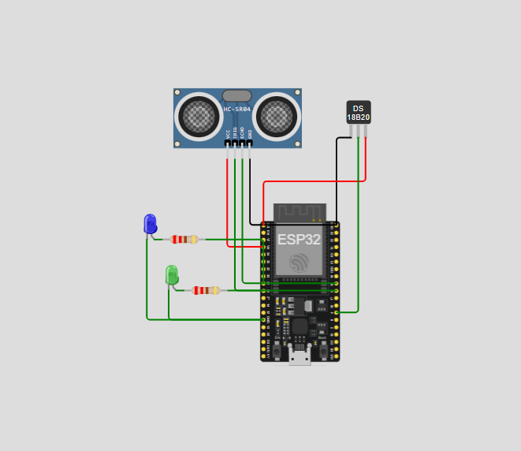
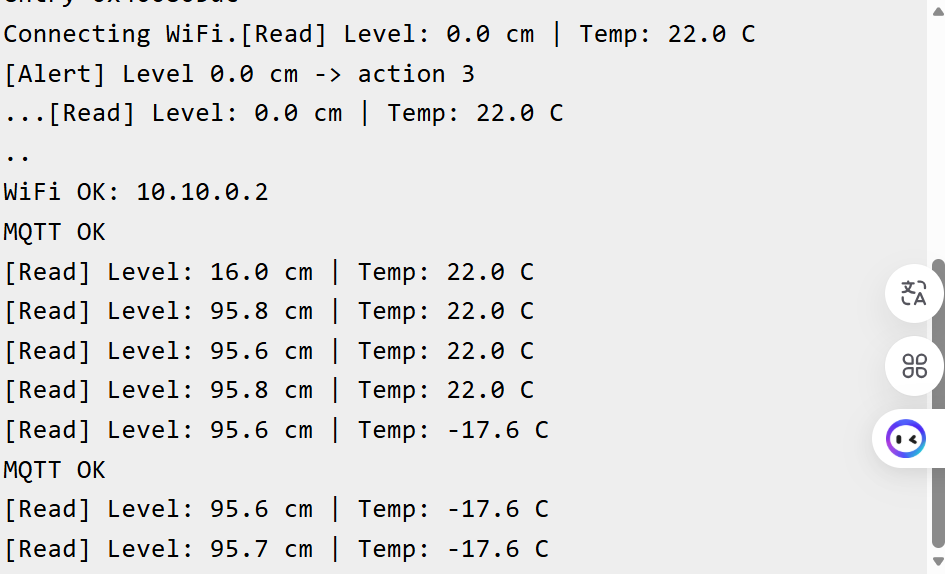
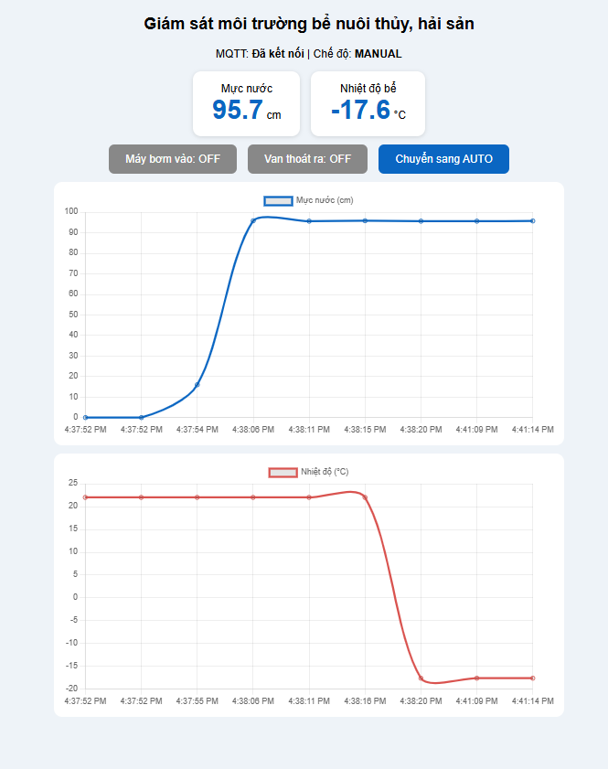
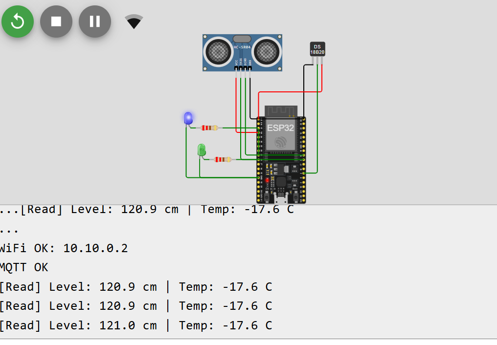
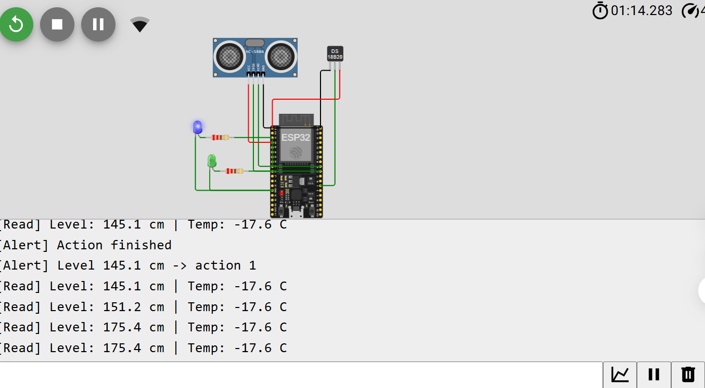
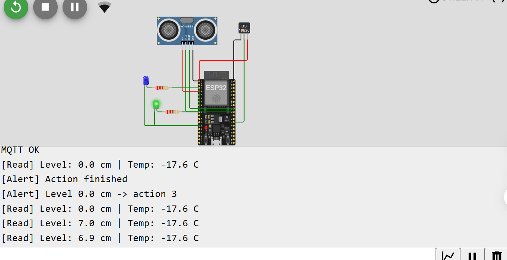
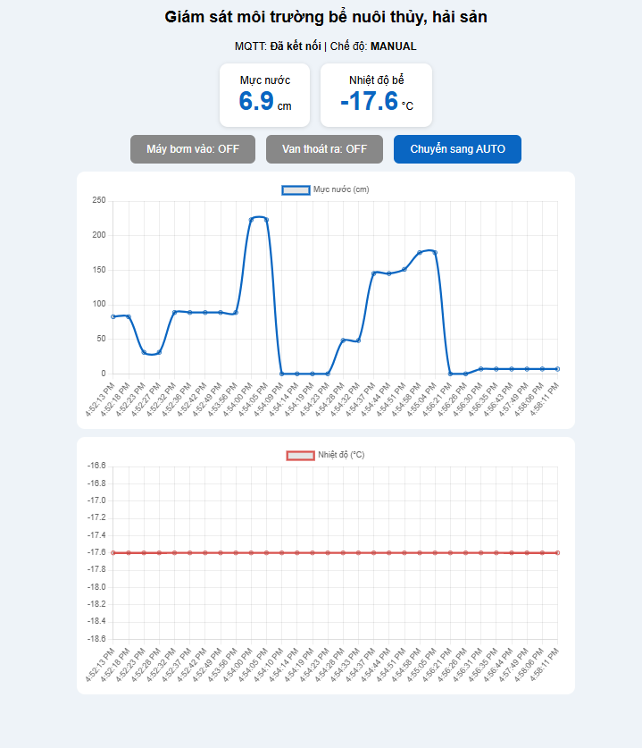
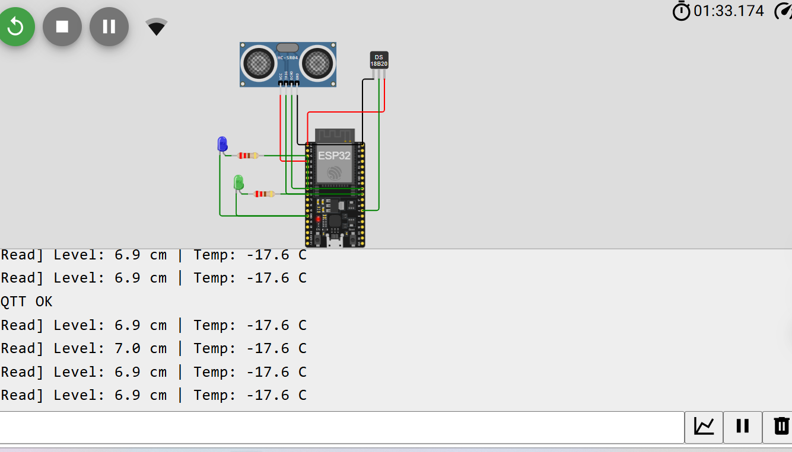

# Báo cáo Lab 3: Giám sát môi trường bể nuôi thủy, hải sản với ESP32, FreeRTOS và MQTT

**Sinh viên:** Lê Văn Luân  
**MSSV:** 231432285  
**Lớp:** N02


## 1. Giới thiệu RTOS và FreeRTOS

### 1.1. Ưu điểm của RTOS (Real-Time Operating System)

RTOS là hệ điều hành thời gian thực. Nó đảm bảo tác vụ được thực thi trong một khoảng thời gian xác định trước, có thể dự đoán được.

- Đa nhiệm (multitasking): chia chương trình thành nhiều Task độc lập (đọc cảm biến, gửi MQTT, điều khiển bơm) thay vì một vòng loop() tuần tự.

- Tính xác định (determinism): bộ lập lịch ưu tiên (priority-based preemptive scheduler) đảm bảo Task quan trọng luôn được chạy kịp thời.

- Module hóa: mỗi Task đảm nhiệm một chức năng, dễ viết, dễ debug, dễ mở rộng và dễ làm việc nhóm.

- Tận dụng phần cứng: ESP32 có 2 core, RTOS cho phép ghim Task vào từng core (core affinity).

- Tránh nghẽn: một Task chờ (Wi-Fi, delay) không làm treo các Task khác, vì Task chờ ở trạng thái Blocked và không chiếm CPU.

- Cơ chế đồng bộ và giao tiếp sẵn có: Queue, Semaphore, Mutex, Event Group, Software Timer.

- Quản lý năng lượng tốt hơn: khi không có Task nào sẵn sàng, hệ thống vào Idle và có thể ngủ.

### 1.2. Ưu điểm và nhược điểm của FreeRTOS

| Ưu điểm                                                             | Nhược điểm                                                                                         |
|---------------------------------------------------------------------|----------------------------------------------------------------------------------------------------|
| Mã nguồn mở (MIT), miễn phí, dùng thương mại được                   | Chỉ là kernel: không có sẵn hệ thống file, mạng, GUI, driver (phải dùng thêm thư viện)             |
| Nhỏ gọn (khoảng 6-12 KB ROM), chạy được trên MCU rất nhỏ            | Không có bộ nhớ ảo, không bảo vệ bộ nhớ (trừ bản MPU) nên một Task lỗi có thể làm hỏng cả hệ thống |
| Đã tích hợp sẵn trong ESP-IDF và Arduino-ESP32, hỗ trợ SMP (2 core) | Cấu hình sai (stack size, priority) dễ gây stack overflow, deadlock, priority inversion            |
| Hỗ trợ trên hơn 40 kiến trúc (ESP32, STM32, ARM, AVR...)            | Đảm bảo real-time ở mức soft, không có kiểm chứng/chứng nhận an toàn trong bản chuẩn               |
| Cộng đồng lớn, tài liệu phong phú                                   | Debug đa luồng khó hơn (race condition, lỗi không lặp lại)                                         |
| API đầy đủ: Task, Queue, Semaphore, Mutex, Timer, Event Group       | Tốn thêm RAM cho mỗi Task (stack + TCB) và overhead chuyển ngữ cảnh                                |

## 2. Cơ chế giao tiếp giữa các Task

### 2.1. Hàng đợi (Queue)

Queue là bộ đệm FIFO an toàn đa luồng. Task này đưa dữ liệu vào bằng xQueueSend(), Task khác lấy ra bằng xQueueReceive(). Dữ liệu được sao chép vào Queue.

- Ưu điểm: truyền được dữ liệu thật (struct, số thực); tách rời Task gửi và nhận (producer-consumer); Task nhận có thể chờ (Blocked) với timeout nên không tốn CPU; không cần biến toàn cục.

- Ứng dụng: truyền giá trị cảm biến từ Task đọc sang Task gửi MQTT, hàng đợi lệnh điều khiển, hàng đợi log.

### 2.2. Cờ hiệu (Semaphore)

| Loại                   | Mục đích                                                                               | Ví dụ                                                             |
|------------------------|----------------------------------------------------------------------------------------|-------------------------------------------------------------------|
| **Binary semaphore**   | Báo hiệu/đồng bộ sự kiện (có / không có)                                               | ISR hoặc Task A báo cho Task B xử lý                              |
| **Counting semaphore** | Đếm số sự kiện hoặc số tài nguyên còn trống                                            | Quản lý pool kết nối                                              |
| **Mutex**              | Khóa độc quyền tài nguyên dùng chung, có cơ chế kế thừa ưu tiên (priority inheritance) | Bảo vệ Serial và biến trạng thái bơm/van dùng chung giữa các Task |

- Ưu điểm: đồng bộ giữa Task và ngắt, tránh race condition, nhẹ hơn Queue khi chỉ cần báo hiệu.

- Trong bài Lab này: dùng 2 Queue (dataQueue, alertQueue) để truyền dữ liệu và 1 Mutex (stateMutex) để bảo vệ trạng thái máy bơm, van và chế độ Manual/Auto, vì biến này bị 2 core cùng ghi.

## 3. Thực hiện bài Lab

### 3.1. Yêu cầu và giả định

- Cảm biến HC-SR04 gắn ở đỉnh bể, hướng xuống mặt nước, đo khoảng cách distance. Mực nước tính bằng level = TANK_H - distance, với chiều cao bể TANK_H = 250 cm. Dải đo 0 đến 2 m phù hợp HC-SR04 (tối đa 4 m).

- Nhiệt độ bể dùng DS18B20 (loại chống nước, phù hợp thực tế).

- Máy bơm mô phỏng bằng LED xanh dương điều khiển PWM (độ sáng tương ứng công suất 50% hoặc 100%). Thực tế dùng MOSFET hoặc module điều khiển bơm. Van thoát mô phỏng bằng LED xanh lá qua chân GPIO (thực tế dùng relay kèm van điện từ).

- MQTT Broker công cộng: broker.hivemq.com (ESP32 dùng TCP 1883, Web dùng WebSocket TLS 8884).

### 3.2. Sơ đồ mạch trong Wokwi và bảng nối chân

Các linh kiện trong Wokwi: ESP32 DevKit C V4, HC-SR04, DS18B20, điện trở 4.7 kΩ, 2 LED (xanh dương = bơm, xanh lá = van), 2 điện trở 220 Ω.

| Linh kiện            | Chân linh kiện    | Chân ESP32 | Ghi chú                                   |
|----------------------|-------------------|------------|-------------------------------------------|
| HC-SR04              | VCC               | 5V (VIN)   | Nguồn 5V                                  |
| HC-SR04              | GND               | GND        |                                           |
| HC-SR04              | TRIG              | GPIO 5     | Output                                    |
| HC-SR04              | ECHO              | GPIO 18    | Input (thực tế cần chia áp 5V xuống 3.3V) |
| DS18B20              | VCC               | 3V3        |                                           |
| DS18B20              | GND               | GND        |                                           |
| DS18B20              | DQ (DATA)         | GPIO 4     | Kéo lên 3V3 bằng điện trở 4.7 kΩ          |
| LED xanh dương (Bơm) | Anode (qua 220 Ω) | GPIO 25    | Xuất PWM 5 kHz, 8 bit                     |
| LED xanh lá (Van)    | Anode (qua 220 Ω) | GPIO 26    | ON/OFF                                    |
| Cả 2 LED             | Cathode           | GND        |                                           |

### 3.3. Triển khai FreeRTOS trên ESP32

#### Bảng dữ liệu các Task

| Task                        | Core  | Priority | Stack | Chức năng                                                                          | Giao tiếp                                               |
|-----------------------------|-------|----------|-------|------------------------------------------------------------------------------------|---------------------------------------------------------|
| TaskMQTT (Task truyền data) | **0** | 2        | 8192  | Kết nối Wi-Fi, kết nối MQTT, nhận lệnh từ Web, đọc dataQueue và publish lên Broker | Nhận từ dataQueue; ghi lệnh vào biến trạng thái (mutex) |
| TaskRead (Task đọc data)    | **1** | 3        | 4096  | Đọc HC-SR04 và DS18B20 mỗi 1 s, in Serial, gửi dữ liệu                             | Gửi struct vào dataQueue, gửi mực nước vào alertQueue   |
| TaskAlert (Task cảnh báo)   | **1** | 2        | 4096  | Đọc alertQueue, điều khiển bơm và van theo thuật toán mực nước                     | Nhận từ alertQueue; ghi trạng thái (mutex)              |

| Đối tượng RTOS | Loại  | Kiểu dữ liệu             | Độ dài | Người gửi           | Người nhận                          |
|----------------|-------|--------------------------|--------|---------------------|-------------------------------------|
| dataQueue      | Queue | SensorData {level, temp} | 5      | TaskRead            | TaskMQTT                            |
| alertQueue     | Queue | float (mực nước, cm)     | 5      | TaskRead            | TaskAlert                           |
| stateMutex     | Mutex |                          |        | TaskMQTT, TaskAlert | Bảo vệ pumpPct, valveOn, manualMode |

#### Thuật toán điều khiển mực nước (Chế độ Auto)

| Mực nước                             | Hành động          | Thời gian |
|--------------------------------------|--------------------|-----------|
| \< 0.5 m (\< 50 cm)                  | Mở Van thoát       | 10 s      |
| 1 m đến 1.5 m                        | Bơm 50% công suất  | 10 s      |
| 1.5 m đến 2 m                        | Bơm 100% công suất | 20 s      |
| Các khoảng còn lại (0.5-1 m, \> 2 m) | Tắt bơm và van     |           |

Trong lúc đang thực hiện một hành động có thời hạn, TaskAlert dùng millis() để đếm thời gian (không dùng delay) nên vẫn đọc được Queue. Hết thời gian, hệ thống tắt thiết bị rồi đánh giá lại mực nước.

Giải pháp thực tế (tùy chọn): thêm khoảng trễ (hysteresis) quanh các ngưỡng để tránh bơm bật/tắt liên tục, và thêm bảo vệ tràn bể (mực \> 2 m thì mở van thoát, tắt bơm).

#### Chủ đề (topic) MQTT

| Topic                  | Chiều       | Nội dung           |
|------------------------|-------------|--------------------|
| lab3/thuysan/level     | ESP32 → Web | Mực nước (cm)      |
| lab3/thuysan/temp      | ESP32 → Web | Nhiệt độ (°C)      |
| lab3/thuysan/pump      | ESP32 → Web | 0, 50 hoặc 100 (%) |
| lab3/thuysan/valve     | ESP32 → Web | ON / OFF           |
| lab3/thuysan/mode      | ESP32 → Web | AUTO / MANUAL      |
| lab3/thuysan/cmd/pump  | Web → ESP32 | ON / OFF           |
| lab3/thuysan/cmd/valve | Web → ESP32 | ON / OFF           |
| lab3/thuysan/cmd/mode  | Web → ESP32 | AUTO / MANUAL      |

### 3.4. Code ESP32 (main.ino)

Thư viện cần có trong Wokwi (libraries.txt): PubSubClient, OneWire, DallasTemperature.

```cpp
#include <WiFi.h>
#include <PubSubClient.h>
#include <OneWire.h>
#include <DallasTemperature.h>

// ---------- Chân kết nối ----------
#define TRIG_PIN   5
#define ECHO_PIN   18
#define ONEWIRE_PIN 4
#define PUMP_PIN   25   // LED xanh dương, PWM
#define VALVE_PIN  26   // LED xanh lá

// ---------- Cấu hình ----------
const char* WIFI_SSID = "Wokwi-GUEST";   // đổi nếu chạy trên mạch thật
const char* WIFI_PASS = "";
const char* MQTT_HOST = "broker.hivemq.com";
const int   MQTT_PORT = 1883;
const char* P = "lab3/thuysan/";
const float TANK_H = 250.0;              // cm, chiều cao từ cảm biến đến đáy

// ---------- Đối tượng RTOS ----------
typedef struct { float level; float temp; } SensorData;
QueueHandle_t dataQueue, alertQueue;
SemaphoreHandle_t stateMutex;

// ---------- Trạng thái dùng chung (bảo vệ bằng stateMutex) ----------
int  pumpPct = 0;
bool valveOn = false;
bool manualMode = false;

WiFiClient espClient;
PubSubClient mqtt(espClient);
OneWire oneWire(ONEWIRE_PIN);
DallasTemperature ds18b20(&oneWire);

// ---------- Điều khiển phần cứng ----------
void pumpWrite(int pct) {
  int duty = map(pct, 0, 100, 0, 255);
#if ESP_ARDUINO_VERSION_MAJOR >= 3
  ledcWrite(PUMP_PIN, duty);
#else
  ledcWrite(0, duty);
#endif
}

// Đặt trạng thái và xuất ra chân (gọi khi đã giữ mutex)
void applyOutputs() {
  pumpWrite(pumpPct);
  digitalWrite(VALVE_PIN, valveOn ? HIGH : LOW);
}

float readDistanceCm() {
  digitalWrite(TRIG_PIN, LOW);  delayMicroseconds(2);
  digitalWrite(TRIG_PIN, HIGH); delayMicroseconds(10);
  digitalWrite(TRIG_PIN, LOW);
  long us = pulseIn(ECHO_PIN, HIGH, 30000);   // timeout 30 ms
  if (us == 0) return -1;
  return us * 0.0343 / 2.0;
}

// ---------- Nhận lệnh từ Web (chạy trong mqtt.loop của TaskMQTT) ----------
void onMessage(char* topic, byte* payload, unsigned int len) {
  String t = topic, m;
  for (unsigned int i = 0; i < len; i++) m += (char)payload[i];
  xSemaphoreTake(stateMutex, portMAX_DELAY);
  if (t == String(P) + "cmd/mode") {
    manualMode = (m == "MANUAL");
    if (manualMode) { pumpPct = 0; valveOn = false; applyOutputs(); }
  } else if (manualMode && t == String(P) + "cmd/pump") {
    pumpPct = (m == "ON") ? 100 : 0;
    applyOutputs();
  } else if (manualMode && t == String(P) + "cmd/valve") {
    valveOn = (m == "ON");
    applyOutputs();
  }
  xSemaphoreGive(stateMutex);
}

void pub(const char* sub, String v) {
  mqtt.publish((String(P) + sub).c_str(), v.c_str());
}

// ================= TASK TRUYỀN DATA - CORE 0 =================
void TaskMQTT(void* pv) {
  mqtt.setServer(MQTT_HOST, MQTT_PORT);
  mqtt.setCallback(onMessage);
  unsigned long lastState = 0;

  for (;;) {
    // 1. Kết nối Wi-Fi
    if (WiFi.status() != WL_CONNECTED) {
      Serial.print("Connecting WiFi");
      WiFi.begin(WIFI_SSID, WIFI_PASS);
      while (WiFi.status() != WL_CONNECTED) {
        vTaskDelay(pdMS_TO_TICKS(500));
        Serial.print(".");
      }
      Serial.println("\nWiFi OK: " + WiFi.localIP().toString());
    }
    // 2. Kết nối MQTT
    if (!mqtt.connected()) {
      String id = "esp32-aqua-" + String((uint32_t)ESP.getEfuseMac(), HEX);
      if (mqtt.connect(id.c_str())) {
        mqtt.subscribe((String(P) + "cmd/#").c_str());
        Serial.println("MQTT OK");
      } else {
        vTaskDelay(pdMS_TO_TICKS(2000));
        continue;
      }
    }
    mqtt.loop();

    // 3. Đọc dataQueue và gửi lên Broker
    SensorData d;
    if (xQueueReceive(dataQueue, &d, pdMS_TO_TICKS(100)) == pdTRUE) {
      pub("level", String(d.level, 1));
      pub("temp",  String(d.temp, 1));
    }

    // 4. Gửi trạng thái cơ cấu chấp hành mỗi 1 s
    if (millis() - lastState > 1000) {
      lastState = millis();
      xSemaphoreTake(stateMutex, portMAX_DELAY);
      pub("pump",  String(pumpPct));
      pub("valve", valveOn ? "ON" : "OFF");
      pub("mode",  manualMode ? "MANUAL" : "AUTO");
      xSemaphoreGive(stateMutex);
    }
  }
}

// ================= TASK ĐỌC DATA - CORE 1 =================
void TaskRead(void* pv) {
  for (;;) {
    float dist = readDistanceCm();
    ds18b20.requestTemperatures();
    float temp = ds18b20.getTempCByIndex(0);

    if (dist >= 0) {
      float level = constrain(TANK_H - dist, 0, TANK_H);
      SensorData d = { level, temp };

      Serial.printf("[Read] Level: %.1f cm | Temp: %.1f C\n", level, temp);

      xQueueSend(dataQueue,  &d,     0);   // dữ liệu đầy đủ -> TaskMQTT
      xQueueSend(alertQueue, &level, 0);   // mực nước -> TaskAlert
    } else {
      Serial.println("[Read] HC-SR04 out of range");
    }
    vTaskDelay(pdMS_TO_TICKS(1000));
  }
}

// ================= TASK CẢNH BÁO - CORE 1 =================
enum Action { IDLE, PUMP50, PUMP100, VALVE };

void TaskAlert(void* pv) {
  Action act = IDLE;
  unsigned long endAt = 0;
  float level;

  for (;;) {
    bool got = (xQueueReceive(alertQueue, &level, pdMS_TO_TICKS(200)) == pdTRUE);

    xSemaphoreTake(stateMutex, portMAX_DELAY);
    if (manualMode) {                 // chế độ Manual: Web điều khiển
      act = IDLE;
      xSemaphoreGive(stateMutex);
      continue;
    }

    // Hết thời gian hành động -> tắt thiết bị
    if (act != IDLE && millis() >= endAt) {
      act = IDLE; pumpPct = 0; valveOn = false; applyOutputs();
      Serial.println("[Alert] Action finished");
    }

    // Đang rảnh và có dữ liệu mới -> chọn hành động
    if (act == IDLE && got) {
      if (level < 50) {
        act = VALVE;   valveOn = true;  endAt = millis() + 10000;
      } else if (level >= 100 && level < 150) {
        act = PUMP50;  pumpPct = 50;    endAt = millis() + 10000;
      } else if (level >= 150 && level <= 200) {
        act = PUMP100; pumpPct = 100;   endAt = millis() + 20000;
      }
      if (act != IDLE) {
        applyOutputs();
        Serial.printf("[Alert] Level %.1f cm -> action %d\n", level, act);
      }
    }
    xSemaphoreGive(stateMutex);
  }
}

// ================= SETUP =================
void setup() {
  Serial.begin(115200);
  pinMode(TRIG_PIN, OUTPUT);
  pinMode(ECHO_PIN, INPUT);
  pinMode(VALVE_PIN, OUTPUT);
#if ESP_ARDUINO_VERSION_MAJOR >= 3
  ledcAttach(PUMP_PIN, 5000, 8);
#else
  ledcSetup(0, 5000, 8);
  ledcAttachPin(PUMP_PIN, 0);
#endif
  ds18b20.begin();

  dataQueue  = xQueueCreate(5, sizeof(SensorData));
  alertQueue = xQueueCreate(5, sizeof(float));
  stateMutex = xSemaphoreCreateMutex();

  //                         hàm      tên         stack  tham số  ưu tiên  handle  core
  xTaskCreatePinnedToCore(TaskMQTT,  "TaskMQTT",  8192, NULL, 2, NULL, 0);
  xTaskCreatePinnedToCore(TaskRead,  "TaskRead",  4096, NULL, 3, NULL, 1);
  xTaskCreatePinnedToCore(TaskAlert, "TaskAlert", 4096, NULL, 2, NULL, 1);
}

void loop() { vTaskDelete(NULL); }   // loop() không dùng, mọi việc do các Task đảm nhiệm
```

#### Giải thích code

1.  Khởi tạo (setup): cấu hình chân, tạo PWM cho bơm, tạo 2 Queue và 1 Mutex, sau đó dùng xTaskCreatePinnedToCore() tạo 3 Task. Tham số cuối là số core: TaskMQTT ghim vào core 0, TaskRead và TaskAlert ghim vào core 1.

2.  Quá trình tạo kết nối (TaskMQTT): Task kiểm tra Wi-Fi trước. Nếu chưa có thì WiFi.begin() rồi chờ bằng vTaskDelay (không chặn các Task khác). Khi Wi-Fi thành công mới kết nối MQTT Broker, rồi subscribe vào lab3/thuysan/cmd/# để nhận lệnh. Nếu rớt mạng, vòng for(;;) tự kết nối lại.

3.  Cập nhật dữ liệu: TaskRead đọc cảm biến mỗi 1 s, in ra Serial, đẩy SensorData vào dataQueue và mực nước vào alertQueue. TaskMQTT chờ dataQueue (timeout 100 ms), có dữ liệu thì publish lên level và temp. Trạng thái bơm, van, chế độ được gửi mỗi giây.

4.  Điều khiển: Web publish lệnh vào cmd/.... Hàm callback onMessage cập nhật trạng thái dưới sự bảo vệ của mutex và xuất ra chân GPIO. Ở chế độ AUTO, TaskAlert quyết định theo mực nước. Ở chế độ MANUAL, TaskAlert nhường quyền cho Web.

5.  Mutex đảm bảo TaskMQTT (core 0) và TaskAlert (core 1) không ghi chồng lên pumpPct, valveOn, manualMode.

### 3.5. Giao diện Web (index.html)

Web dùng thư viện **MQTT.js** (kết nối WebSocket qua wss://broker.hivemq.com:8884/mqtt) và **Chart.js** để vẽ 2 biểu đồ thời gian thực. Dữ liệu hiển thị trong các thẻ có class="value", 3 nút button điều khiển (Bơm, Van, chế độ Manual/Auto).

```html
<!DOCTYPE html>
<html lang="vi">
<head>
<meta charset="UTF-8">
<meta name="viewport" content="width=device-width, initial-scale=1">
<title>Giám sát bể thủy sản</title>
<script src="https://cdn.jsdelivr.net/npm/mqtt@5.3.4/dist/mqtt.min.js"></script>
<script src="https://cdn.jsdelivr.net/npm/chart.js@4.4.1"></script>
<style>
  body{font-family:Arial,sans-serif;background:#eef3f8;margin:0;padding:16px;text-align:center}
  .cards,.btns{display:flex;gap:16px;justify-content:center;flex-wrap:wrap;margin:12px 0}
  .card{background:#fff;border-radius:12px;padding:16px 28px;box-shadow:0 2px 6px #0002}
  .value{font-size:2.4rem;font-weight:bold;color:#0a66c2}
  .chart-box{background:#fff;border-radius:12px;padding:12px;margin:12px auto;max-width:720px}
  button{padding:12px 24px;font-size:1rem;border:0;border-radius:8px;color:#fff;background:#888;cursor:pointer}
  button.on{background:#2e9e4f}
</style>
</head>
<body>
<h2>Giám sát môi trường bể nuôi thủy, hải sản</h2>
<p>MQTT: <b id="status">Đang kết nối...</b> | Chế độ: <b id="mode">--</b></p>

<div class="cards">
  <div class="card">Mực nước<br><span class="value" id="level">--</span> cm</div>
  <div class="card">Nhiệt độ bể<br><span class="value" id="temp">--</span> °C</div>
</div>

<div class="btns">
  <button id="btnPump">Máy bơm vào: OFF</button>
  <button id="btnValve">Van thoát ra: OFF</button>
  <button id="btnMode" style="background:#0a66c2">Chuyển sang MANUAL</button>
</div>

<div class="chart-box"><canvas id="chLevel"></canvas></div>
<div class="chart-box"><canvas id="chTemp"></canvas></div>

<script>
const P = 'lab3/thuysan/';
const client = mqtt.connect('wss://broker.hivemq.com:8884/mqtt');
const $ = id => document.getElementById(id);
let pumpOn = false, valveOn = false, manual = false;

// ----- Biểu đồ thời gian thực -----
function makeChart(id, label, color) {
  return new Chart($(id), {
    type: 'line',
    data: { labels: [], datasets: [{ label, data: [], borderColor: color, tension: .3 }] },
    options: { animation: false }
  });
}
const chLevel = makeChart('chLevel', 'Mực nước (cm)', '#0a66c2');
const chTemp  = makeChart('chTemp',  'Nhiệt độ (°C)', '#d9534f');
function addPoint(chart, v) {
  chart.data.labels.push(new Date().toLocaleTimeString());
  chart.data.datasets[0].data.push(v);
  if (chart.data.labels.length > 30) {
    chart.data.labels.shift(); chart.data.datasets[0].data.shift();
  }
  chart.update();
}

// ----- Kết nối và nhận dữ liệu -----
client.on('connect', () => {
  $('status').textContent = 'Đã kết nối';
  client.subscribe(P + '+');          // level, temp, pump, valve, mode
});
client.on('close', () => $('status').textContent = 'Mất kết nối');

client.on('message', (topic, payload) => {
  const v = payload.toString();
  switch (topic.replace(P, '')) {
    case 'level': $('level').textContent = v; addPoint(chLevel, +v); break;
    case 'temp':  $('temp').textContent  = v; addPoint(chTemp,  +v); break;
    case 'pump':
      pumpOn = +v > 0;
      $('btnPump').textContent = 'Máy bơm vào: ' + (pumpOn ? v + '%' : 'OFF');
      $('btnPump').className = pumpOn ? 'on' : '';
      break;
    case 'valve':
      valveOn = (v === 'ON');
      $('btnValve').textContent = 'Van thoát ra: ' + v;
      $('btnValve').className = valveOn ? 'on' : '';
      break;
    case 'mode':
      manual = (v === 'MANUAL');
      $('mode').textContent = v;
      $('btnMode').textContent = manual ? 'Chuyển sang AUTO' : 'Chuyển sang MANUAL';
      break;
  }
});

// ----- Điều khiển (publish lệnh) -----
$('btnPump').onclick  = () => manual && client.publish(P + 'cmd/pump',  pumpOn ? 'OFF' : 'ON');
$('btnValve').onclick = () => manual && client.publish(P + 'cmd/valve', valveOn ? 'OFF' : 'ON');
$('btnMode').onclick  = () => client.publish(P + 'cmd/mode', manual ? 'AUTO' : 'MANUAL');
</script>
</body>
</html>
```

#### Giải thích code Web

- mqtt.connect('wss://...') mở kết nối WebSocket tới Broker. Khi connect xong, Web subscribe vào lab3/thuysan/+ để nhận mọi dữ liệu một cấp (level, temp, pump, valve, mode).

- Sự kiện message phân loại theo topic: cập nhật số vào thẻ class="value", thêm điểm vào biểu đồ (giữ tối đa 30 điểm) và đổi màu nút theo trạng thái thật do ESP32 báo về. Nhờ vậy giao diện luôn phản ánh trạng thái thực của thiết bị.

- Nút bấm chỉ publish lệnh ON/OFF lên cmd/.... Hai nút Bơm và Van chỉ hoạt động khi ở chế độ MANUAL. Nút thứ ba chuyển qua lại AUTO/MANUAL.

- Có thể mở trực tiếp file index.html hoặc đưa lên GitHub Pages để truy cập từ xa.

### 3.6. Quy trình chạy thử

1.  Mở https://wokwi.com, tạo project ESP32, dựng mạch theo bảng nối chân (mục 3.2).

2.  Dán code vào sketch.ino, thêm thư viện trong libraries.txt, bấm **Start Simulation**.

3.  Mở Serial Monitor, kiểm tra các dòng WiFi OK, MQTT OK, \[Read\] Level ... Temp ....

4.  Mở index.html trên trình duyệt, kiểm tra dữ liệu về và biểu đồ chạy.

5.  Kéo thanh khoảng cách của HC-SR04 trong Wokwi (ví dụ 100 cm tương ứng mực 150 cm) để kiểm tra từng khoảng mực nước. Đổi nhiệt độ DS18B20 để thử cảm biến nhiệt.

6.  Bấm **Chuyển sang MANUAL** và thử các nút Bơm, Van.

## 4. Kết quả đạt được

Sơ đồ mạch Wokwi:



Serial Monitor hiển thị mực nước, nhiệt độ:



Giao diện Web: 2 thẻ số và 2 biểu đồ realtime:



Mực nước 100-150 cm: LED bơm sáng 50% trong 10 s:



Mực nước 150-200 cm: LED bơm sáng 100% trong 20 s:



Mực nước \< 50 cm: LED van sáng 10 s:



Chế độ Manual: bấm nút Web, LED đổi trạng thái:





**Nhận xét:** hệ thống chạy đúng yêu cầu: 3 Task chạy song song trên 2 core, dữ liệu được truyền an toàn qua Queue, việc Wi-Fi/MQTT bị chậm không làm ảnh hưởng đến việc đọc cảm biến và điều khiển bơm/van. Hạn chế: dùng broker công cộng (không bảo mật), mô phỏng bơm và van bằng LED, chưa có hysteresis và lưu lịch sử dữ liệu.

**Hướng phát triển:** thêm xác thực MQTT (user/password, TLS), lưu dữ liệu vào InfluxDB/Grafana, thêm cảm biến pH/độ mặn/oxy hòa tan, thêm cảnh báo qua Telegram.


## Tài liệu tham khảo

- FreeRTOS Documentation: https://www.freertos.org/Documentation

- Espressif, FreeRTOS (ESP-IDF Programming Guide)

- Wokwi Docs: ESP32, HC-SR04, DS18B20

- PubSubClient, MQTT.js, Chart.js, HiveMQ Public Broker
